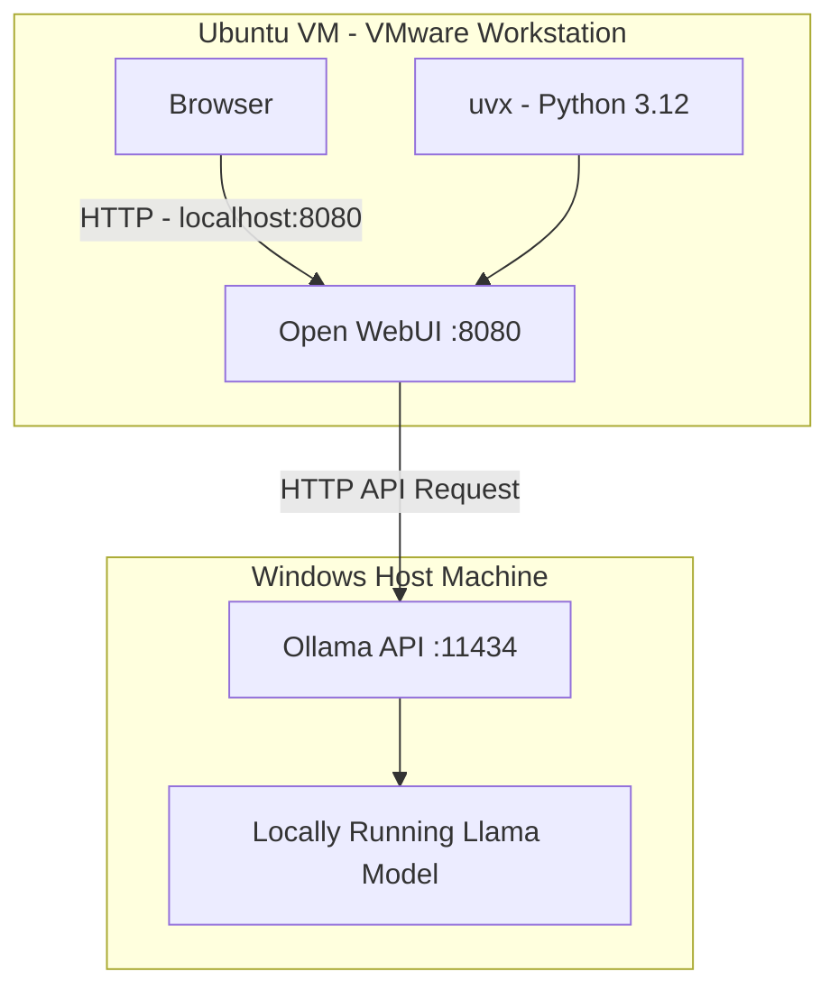

# Local AI Setup Using Ollama, Open WebUI and VMware

A hands-on project to explore local AI, Linux, Python environment management, virtualization, networking and communication between services running in separate environments.

## Overview

This project demonstrates how to run a local AI chatbot using **Ollama** and **Open WebUI**, with the backend and frontend running on two separate environments.

Instead of running everything on one machine, I configured:

- **Windows Host:** Runs Ollama and the locally downloaded Llama model.
- **Ubuntu VM:** Runs Open WebUI as the frontend.
- **VMware NAT (VMnet8):** Enables communication between the Windows host and Ubuntu virtual machine.

The objective was to understand how services communicate over a network and gain practical experience with Linux, virtualization, API connectivity and troubleshooting.

## Architecture



### Technologies Used

| Technology | Purpose |
|---|---|
| Windows 11 | Host operating system |
| Ubuntu 26.04.1 LTS | Runs Open WebUI |
| Ollama | Local AI model runtime and API |
| Open WebUI | Browser-based chatbot interface |
| Python 3.12 | Runtime selected for Open WebUI |
| Python 3.14.4 | Python version also available in Ubuntu |
| uv 0.13.6 | Python version and package management |
| uvx | Runs Open WebUI in an isolated tool environment |
| VMware Workstation | Virtualization |
| VMware NAT (VMnet8) | Host-to-guest network connectivity |

## Network Configuration

The VMware network adapter uses **NAT (VMnet8)**.

The following are the IP addresses from my working setup:

| Component | IP address | Service port |
|---|---|---|
| Windows VMnet8 adapter | `192.168.72.1` | `11434` (Ollama API) |
| Ubuntu VM | `192.168.72.128` | `8080` (Open WebUI) |

**Note:** These are the addresses in my current setup. They may change if VMware's network configuration or DHCP assignments change.

### Check the Ubuntu IP address

Inside Ubuntu:

```bash
ip addr
```

Look for the `ens33` network interface and its IPv4 address.

### Check the Windows VMnet8 IP address

In Windows PowerShell:

```powershell
ipconfig
```

Look for:

```text
VMware Network Adapter VMnet8
IPv4 Address: 192.168.72.1
```

## Windows – Ollama Backend Setup

### Step 1: Check Ollama installation

Open PowerShell:

```powershell
ollama --version
```

### Step 2: Check downloaded models

```powershell
ollama list
```

This displays the models downloaded and available locally.

### Step 3: Test Ollama locally

```powershell
curl.exe http://localhost:11434/api/tags
```

A successful response returns JSON containing information about the locally available models.

### Step 4: Configure Ollama to accept connections from Ubuntu

By default, Ollama listens on the Windows loopback interface (`127.0.0.1:11434`).

Since Open WebUI runs inside a separate Ubuntu VM, it cannot access Ollama through the Windows loopback address.

To allow connections through the Windows network interfaces, Ollama needs to listen on `0.0.0.0:11434`.

For my setup, I used the following temporary PowerShell configuration:

1. Quit Ollama from the Windows system tray.
2. Open PowerShell.
3. Run:

```powershell
$env:OLLAMA_HOST = "0.0.0.0:11434"
ollama serve
```

Keep this terminal open while using Ollama.

**Important:** This environment variable applies to the current PowerShell session and the Ollama process started from it. It is not a permanent Windows configuration.

### Step 5: Verify Ollama is listening

Open another PowerShell window:

```powershell
netstat -ano | findstr :11434
```

Expected output:

```text
TCP    0.0.0.0:11434    0.0.0.0:0    LISTENING
```

This confirms that Ollama is listening on all IPv4 network interfaces.

### Step 6: Configure Windows Firewall

I created an inbound Windows Firewall rule to allow connections to Ollama from the Ubuntu VM:

```powershell
New-NetFirewallRule `
  -DisplayName "Ollama Ubuntu VM" `
  -Direction Inbound `
  -Protocol TCP `
  -LocalPort 11434 `
  -RemoteAddress 192.168.72.128 `
  -Action Allow `
  -Profile Any
```

This rule allows inbound TCP connections to port `11434` from the specified Ubuntu VM address.

**Security considerations:**

- Ollama's API does not provide authentication by default.
- Avoid exposing port `11434` to the public internet.
- Restrict access to the required VM address and network.
- Review other firewall rules to ensure they do not unintentionally permit wider access.

## Ubuntu – Open WebUI Frontend Setup

### Step 1: Install uv

`uv` is a Python package and environment manager.

I installed it using the official installation script:

```bash
curl -LsSf https://astral.sh/uv/install.sh | sh
```

Reload the shell environment:

```bash
source "$HOME/.local/bin/env"
```

Verify the installation:

```bash
uv --version
```

Installed version:

```text
uv 0.13.6
```

### Step 2: Install Python 3.12

Ubuntu already had Python 3.14.4 available.

However, I used Python 3.12 specifically for Open WebUI to meet its Python runtime requirements, without replacing the system Python installation.

```bash
uv python install 3.12
```

Check the available Python versions:

```bash
uv python list
```

### Step 3: Create an application data directory

```bash
mkdir -p ~/open-webui-data
```

This directory provides a persistent location for Open WebUI application data, including chat history and settings.

### Step 4: Start Open WebUI

I used `uvx` to run Open WebUI with Python 3.12.

```bash
DATA_DIR="$HOME/open-webui-data" \
OLLAMA_BASE_URL="http://192.168.72.1:11434" \
uvx --python 3.12 open-webui@latest serve --host 0.0.0.0 --port 8080
```

**What each part does:**

| Configuration | Purpose |
|---|---|
| `DATA_DIR` | Specifies where Open WebUI stores application data |
| `OLLAMA_BASE_URL` | Specifies the Windows Ollama API endpoint |
| `uvx` | Runs a Python application in an isolated tool environment |
| `--python 3.12` | Selects Python 3.12 |
| `open-webui@latest` | Runs the latest available Open WebUI package |
| `serve` | Starts the Open WebUI server |
| `--host 0.0.0.0` | Listens on all VM network interfaces |
| `--port 8080` | Runs the web interface on port 8080 |

The first run downloads Open WebUI and its required dependencies.

### Step 5: Verify the Open WebUI server

Open another Ubuntu terminal:

```bash
ss -lntp | grep 8080
```

My confirmed output:

```text
LISTEN 0 2048 0.0.0.0:8080 0.0.0.0:* users:(("python",pid=5884,fd=34))
```

This confirms that Open WebUI is listening on port `8080`.

### Step 6: Test Ollama connectivity from Ubuntu

Before opening the chatbot, verify that Ubuntu can reach the Windows Ollama API:

```bash
curl http://192.168.72.1:11434/api/tags
```

A successful JSON response confirms that the Ollama API is reachable from Ubuntu.

## Starting the Application

The following steps describe how I start the application after shutting down the environments.

### 1. Start VMware

Start VMware Workstation and power on the Ubuntu virtual machine.

### 2. Start Ollama on Windows

Open PowerShell:

```powershell
$env:OLLAMA_HOST = "0.0.0.0:11434"
ollama serve
```

Keep this terminal running.

### 3. Start Open WebUI

Inside Ubuntu:

```bash
DATA_DIR="$HOME/open-webui-data" \
OLLAMA_BASE_URL="http://192.168.72.1:11434" \
uvx --python 3.12 open-webui@latest serve --host 0.0.0.0 --port 8080
```

Keep this terminal running.

### 4. Open the chatbot

Open Chrome and visit:

```text
http://192.168.72.128:8080
```

If accessing it from another machine, ensure the Ubuntu VM's firewall and network configuration permit access to port `8080`.

Select an available model and start chatting!

## Troubleshooting

Some of the main issues encountered during this project involved communication between the Windows host and Ubuntu VM.

| Issue | What to check |
|---|---|
| Ubuntu cannot reach Ollama | Check the Windows Ollama listening address |
| Connection refused on port 11434 | Check whether `ollama serve` is running |
| Ollama API inaccessible from Ubuntu | Check VMware NAT connectivity and Windows Firewall |
| Incorrect host IP | Verify the VMnet8 address using `ipconfig` |
| Open WebUI unavailable | Check whether the service is running on port 8080 |
| Open WebUI cannot find models | Verify `OLLAMA_BASE_URL` and test the API from Ubuntu |

Useful network troubleshooting commands:

**Windows:**

```powershell
ipconfig
netstat -ano | findstr :11434
```

**Ubuntu:**

```bash
ip addr
ping 192.168.72.1
curl http://192.168.72.1:11434/api/tags
ss -lntp | grep 8080
```

## Security Considerations

- Do not expose Ollama's API directly to the public internet.
- Restrict inbound connections to the necessary network addresses.
- Be careful when using `0.0.0.0`, as it makes a service listen on all available network interfaces.
- Do not publish passwords, authentication tokens or private configuration.
- Avoid committing local application databases or personal chat history to GitHub.

## Key Learnings

Through this project, I gained practical experience with:

- Linux commands and Ubuntu administration.
- Python version and environment management using `uv`.
- Running Python applications using `uvx`.
- Virtualization using VMware Workstation.
- VMware NAT networking and host-to-guest communication.
- HTTP APIs and client-server architecture.
- Environment variables and application configuration.
- Listening ports, firewall rules and network troubleshooting.
- Running local AI models and connecting them to a web interface.

## Conclusion

This project helped me understand how applications running in separate environments communicate with each other.

Rather than simply installing tools, I got hands-on experience configuring services, managing Python environments, setting up network connectivity and troubleshooting issues between a Windows host and an Ubuntu virtual machine.
