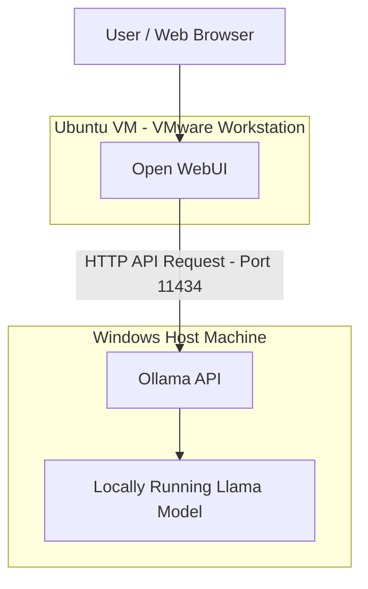

# Local AI Setup Using Ollama, Open WebUI and VMware

A hands-on project exploring local AI, Linux, virtualization, networking and communication between separate environments.

## Overview

This project demonstrates how to run a local AI chatbot using **Ollama** and **Open WebUI**, with the backend and frontend operating in separate environments.

Instead of running everything on one machine, I configured Ollama on my Windows host machine and ran Open WebUI inside an Ubuntu virtual machine using VMware Workstation.

The two environments communicate over VMware's NAT network.

## Architecture



## Technologies Used

- **Ollama** – Runs the AI model locally and provides an API.
- **Open WebUI** – Provides a browser-based chatbot interface.
- **Ubuntu Linux** – Hosts the Open WebUI frontend.
- **VMware Workstation** – Runs the Ubuntu virtual machine.
- **Windows PowerShell** – Used to manage and troubleshoot the Ollama backend.
- **VMware NAT networking** – Enables communication between the Ubuntu VM and Windows host.

## Environment Setup

### 1. Windows Host – Ollama Backend

- Installed and configured Ollama on Windows.
- Downloaded and ran a Llama model locally.
- Used PowerShell to manage Ollama and check its status.
- Used Ollama's API on port `11434`.

Useful commands:

```powershell
ollama list
```

Check whether something is listening on port 11434:

```powershell
netstat -ano | findstr :11434
```

### 2. Ubuntu VM – Open WebUI Frontend

- Created an Ubuntu virtual machine using VMware Workstation.
- Used `uv` for Python version and environment management.
- Installed Open WebUI and its dependencies using `uv`.
- Used a separate Python environment to accommodate Open WebUI's Python version requirements.
- Started the Open WebUI service and accessed its browser interface.

Open WebUI was available on port `8080` in my setup.

**Why uv?**

I used `uv` because Open WebUI had different Python version requirements from the Python environment I was initially working with. It helped me manage the appropriate Python environment and install the required dependencies without interfering with other Python projects.

### 3. Connecting Ubuntu to Windows

The Ubuntu VM and Windows host communicated over VMware NAT networking (VMnet8).

Open WebUI needed to reach the Ollama API running on the Windows host.

The connection used the Windows host's VMnet8 network address and Ollama's API port:

```text
http://<WINDOWS_VMNET8_IP>:11434
```

The exact connection setting used in Open WebUI should be confirmed from the running configuration before reproducing this setup.

To identify the Windows host's network addresses:

```powershell
ipconfig
```

To test connectivity from Ubuntu:

```bash
ping <WINDOWS_VMNET8_IP>
```

To check whether the Ollama API is reachable:

```bash
curl http://<WINDOWS_VMNET8_IP>:11434/api/tags
```

A successful API response should return information about the models available to Ollama.

## Challenges and Troubleshooting

Getting the two environments to communicate was one of the main challenges.

Some of the issues I worked through included:

- Ollama initially listening only on the Windows loopback interface.
- Checking the Windows VMnet8 network adapter and identifying the correct host address.
- Troubleshooting VMware NAT connectivity.
- Checking Windows Firewall rules and port accessibility.
- Verifying that the Ollama API could be reached from Ubuntu.
- Checking that Open WebUI was running and listening on the expected port.

These troubleshooting steps helped me understand how network interfaces, IP addresses, ports, firewall rules and services affect communication between machines.

## Key Learnings

Through this project, I gained practical exposure to:

- Basic Linux commands and Ubuntu administration.
- Virtual machines and VMware Workstation.
- NAT networking and communication between a host and guest machine.
- Client-server architecture.
- HTTP APIs and service connectivity.
- Checking listening ports and troubleshooting network access.
- Running a local AI model and connecting it to a web interface.

## Security Considerations

Ollama's API should not be exposed directly to the public internet.

When configuring Ollama to accept connections from another environment, restrict access using appropriate Windows Firewall rules and allow only the required network traffic.

Avoid committing private IP details, credentials, API keys or other sensitive configuration to this repository.

## Possible Future Improvements

- Document the exact Ollama model and version.
- Record the final Open WebUI-to-Ollama connection configuration.
- Add screenshots of the working chatbot and API connectivity.
- Explore monitoring and service management.
- Experiment with a more automated setup.

## Conclusion

This was a useful hands-on exercise in connecting services running in separate environments. It helped me move beyond simply installing tools and understand how the underlying networking and communication work.

I plan to build on this experience as I continue learning Linux, Cloud Computing and DevOps.
